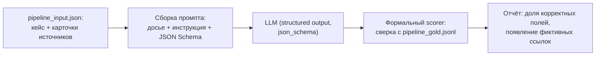
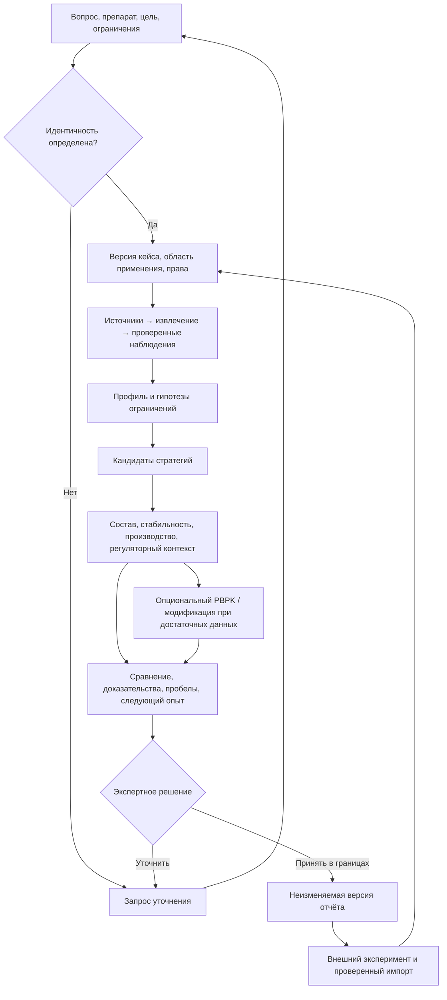
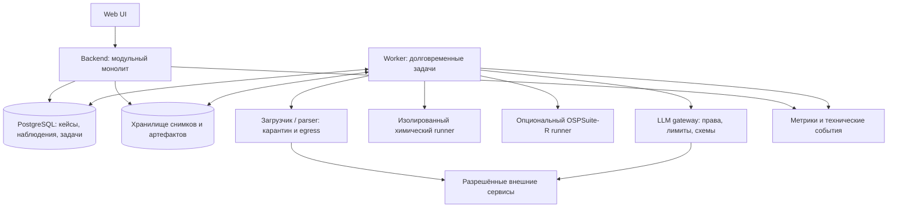
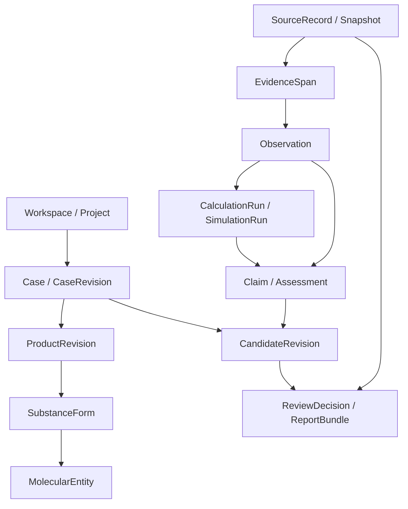
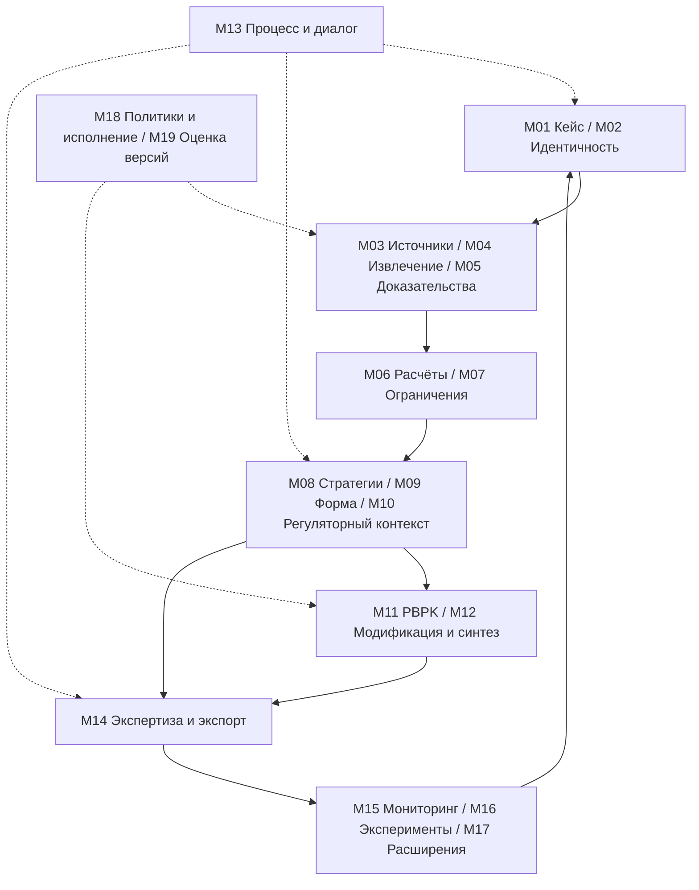

# ML System Design Doc — absorbix-ai

## Дизайн ML системы — absorbix-ai <MVP> <v1>

*Шаблон [Reliable ML](https://github.com/IrinaGoloshchapova/ml_system_design_doc_ru)*

- **Проект:** ИИ-платформа оптимизации всасывания и лекарственной формы препаратов (absorbix-ai)
- **Автор:** [WooperWise](https://github.com/WooperWise)
- **Статус:** исследовательский прототип (дипломная проектная практика)
- **Дата:** 20.10.2026
- **Код проекта:** https://github.com/WooperWise/absorbix-ai

> **Термины.** Итерация — все работы до старта очередного пилота. БТ — бизнес-требования. Роли `Product Owner` / `Data Scientist` в дипломном проекте совмещает автор; предметная экспертиза — профильные специалисты (фармаколог, химик, PK-моделист, регуляторный специалист).

---

## 1. Цели и предпосылки

### 1.1. Зачем идём в разработку продукта?

**Бизнес-цель** (`Product Owner`)

Фармаколог или специалист по фармацевтической технологии, оптимизирующий всасывание препарата, вручную собирает разрозненные данные: физико-химические свойства молекулы, BCS-класс, составы референтных продуктов, допустимость вспомогательных веществ, руководства ICH/FDA, литературу по стратегиям (соли, пролекарства, твёрдые дисперсии, нанокристаллы). Данные разбросаны по DailyMed, Orange Book, PubChem, ChEMBL, Europe PMC, ГРЛС и сотням статей; сбор досье по одному кейсу занимает дни.

**Почему станет лучше, чем сейчас, от использования ML** (`Product Owner` & `Data Scientist`)

Прямой запрос к LLM задачу не решает: модели путают свойства молекул, придумывают исследования, не различают сильные и слабые доказательства, не учитывают ограничения по вспомогательным веществам и условиям хранения. Строим не чат-бот, а **систему поддержки предэкспериментального решения**: какие варианты изменения конкретного препарата разумно проверить экспериментально, на основании каких данных, при каких ограничениях и с какими нерешёнными вопросами. LLM-извлечение с structured output + детерминированные расчётные инструменты (RDKit, OSPSuite, ADMET-инструменты) + проверяемая доказательная база дают то, чего нет ни у ручного процесса (скорость), ни у чистой LLM (проверяемость).

**Что будем считать успехом итерации с точки зрения бизнеса** (`Product Owner`)

Единица работы — **исследовательский кейс** (вещество → форма субстанции → продукт → доза и условия → цель изменения), а не запрос к чат-боту. Целевой выход — **пакет поддержки решения**: профиль с происхождением данных, гипотезы об ограничивающем факторе, ограниченный набор альтернатив с проверками применимости, явные пробелы, план дальнейшей проверки и воспроизводимая версия отчёта. Успех итерации — прохождение основного оцениваемого режима (фиксированное досье → структурированный ответ) на собранном датасете с проверяемыми ссылками у каждого предметного утверждения.

### 1.2. Бизнес-требования и ограничения

**Краткое описание БТ** (`Product Owner`)

| ID | Требование |
|---|---|
| BR-1 | Пользователь вводит МНН, торговое название или структуру молекулы и получает профиль препарата: физико-химические свойства, BCS, pH-зависимая растворимость, проницаемость, субстратность транспортёров, метаболизм первого прохождения, влияние пищи, стабильность в ЖКТ |
| BR-2 | Диагностика ограничивающего фактора всасывания: растворимость / проницаемость / химическая нестабильность / метаболизм первого прохождения; допустимы несколько гипотез одновременно |
| BR-3 | Подбор стратегий оптимизации под ограничивающий фактор: пероральные формы, парентеральные формы, соли, сокристаллы, пролекарства — с обоснованием, оценкой выигрыша, рисков и стоимости |
| BR-4 | Каждый вывод сопровождается ссылкой на источник и уровнем доказательности; связь «утверждение — основание» проверяема до конкретного фрагмента |
| BR-5 | Диалоговые уточнения («только перорально», «без ПАВ», «хранение при комнатной температуре») пересобирают варианты |
| BR-6 | Экспорт результата в автономный HTML и PDF со ссылками и ограничениями |
| BR-7 | Работа с частными брендами компаний-партнёров без передачи данных наружу; секреты не покидают контур |

Детальные требования — ТЗ проекта `DESCR(1).md` в репозитории absorbix-ai.

**Бизнес-ограничения** (`Product Owner`)

| ID | Ограничение |
|---|---|
| C-1 | LLM за OpenAI-совместимым API (`OPENAI_BASE_URL`); тестовая конфигурация — vLLM с локальной моделью; частные данные партнёров не передаются внешним сервисам |
| C-2 | Обязательное различение молекулы, формы субстанции и готового продукта: один INN не определяет рецептуру; неизвестное количество не заменяется нулём или догадкой |
| C-3 | Право использования каждого источника проверяется до загрузки, передачи и экспорта |
| C-4 | Регуляторный контекст: ICH Q8/Q9, M9, M13A, M15 (модельные доказательства); система не выдаёт автоматических регуляторных решений |
| C-5 | Небольшая команда дипломного этапа — архитектура без обязательных микросервисов |
| C-6 | Корректный отрицательный результат («данных недостаточно») — валидный и обязательный выход, а не техническая ошибка |

**Запрещённое применение:** назначение лечения пациенту, утверждение безопасности нового состава, выдача дозировок для самостоятельного применения, автоматическая регистрационная оценка, управление синтезом или лабораторным оборудованием.

**Что мы ожидаем от конкретной итерации** (`Product Owner`)

Первая итерация закрывает основной контур: фиксированное досье → идентификация → извлечение наблюдений → диагностика ограничений → кандидаты стратегий с проверками применимости → структурированный отчёт с провенансом. End-to-end веб-поиск, разбор сырых PDF и положительно валидированный PBPK — вне итерации.

**Описание бизнес-процесса пилота** (`Product Owner`)

Специалист открывает кейс: выбирает продукт/молекулу, цель разработки (экспозиция, профиль высвобождения, биоэквивалентность, стабильность, удобство применения, производственная реализуемость), путь введения, ограничения. Система возвращает пакет поддержки решения; в чате уточняются ограничения и пересобираются варианты. Специалист (в своей роли: фармаколог, химик, PK-моделист, регуляторный специалист) принимает решение «использовать как основание для следующего исследовательского действия в указанных границах» — фиксируется неизменяемая версия отчёта (HTML/PDF). Результаты реального эксперимента возвращаются в систему отдельным проверяемым потоком. Система **не выбирает окончательную рецептуру автоматически** и не заменяет эксперимент.

**Что считаем успешным пилотом? Критерии успеха и пути развития** (`Product Owner`)

- 100% предметных утверждений в отчёте имеют проверяемую ссылку на источник (фрагмент + версия).
- На сценариях датасета система выдаёт корректные отказы/пробелы вместо бессодержательных ответов (нет «фиктивного продукта», «нулевой дозы», выдуманных ссылок).
- Время сбора первичного досье и сравнения стратегий по кейсу сокращается с дней до часов.
- Пути развития при успехе: интеграция в большую платформу компании через HTTP API, частные данные партнёров, ветка мониторинга литературы (M15), PBPK (M11), ретросинтез (M12).

### 1.3. Что входит в скоуп проекта/итерации, что не входит

**Что закрываем в данной итерации** (`Data Scientist`)

- Модули M01–M05: кейс и требования, идентичность вещества/продукта, получение и версии источников, извлечение и нормализация наблюдений, досье доказательств с картой противоречий.
- M06–M08: вычислительные инструменты (по нужным endpoints), оценка ограничивающих факторов, каталог и отбор стратегий.
- M09, M10 (базовые справки): форма/состав/технологические ограничения, регуляторный контекст.
- M13, M14, M18, M19: управляемый workflow и диалог, экспертное решение и экспорт отчёта, доступ и исполнение, оценка качества версий.
- Датасет Pharma Decision Workflow v1.0.0: 160 сценариев / 20 контекстов, 75 пар совместимости (FormulationDE Table S1), 24 контрактные фикстуры.

**Что не будет закрыто** (`Data Scientist`)

- Положительно валидированный PBPK (M11 — только при достаточности данных), ретросинтез (M12), мониторинг литературы и патентов (M15), автоматизация экспериментов (M16), поиск возможностей генериков и гипотез безопасности (M17).
- Разбор сырых PDF/сканов и полная веб-поисковая ветка; обучение новой универсальной фармацевтической модели.
- Регулируемое применение: система не является 21 CFR Part 11-системой; переход — отдельный проект.
- Работа с реальными частными данными партнёров до согласования доступа.

**Результат с точки зрения качества кода и воспроизводимости** (`Data Scientist`)

- Все контракты данных — JSON Schema 2020-12 (pipeline_input, observation, case_revision, module_result, benchmark_response и др.) с синтетическими примерами и контрактными тестами.
- Воспроизводимость: версии источников (snapshot + hash), версии кейса (`CaseRevision`), неизменяемый отчёт (`ReportBundle`), фиксированные версии модели и промптов в `BenchmarkManifest`.
- Окружение: uv + lock-файл, ruff/pre-commit, Docker; smoke-тесты LLM-инференса (`scripts/check_local_model.py`).

**Планируемый технический долг** (`Data Scientist`)

- Разметка датасета в статусе `draft_for_expert_review` — до согласования экспертом метрики качества ограничены формальным scorer'ом.
- Test-контур датасета просмотрен — не слепой holdout для настройки промптов.
- Извлечение из сканов/таблиц сложной вёрстки — очередь проверки куратором вместо полной автоматизации.
- Векторный поиск — производный объект поверх PostgreSQL FTS, не отдельное хранилище.

### 1.4. Предпосылки решения

**Обоснование от запроса бизнеса: какие блоки данных и техники используем** (`Data Scientist`)

- **Доказательная база (ядро):** карточки источников с провенансом (SHA-256, версии, права), наблюдения с единицами UCUM, локаторами фрагментов и происхождением. Без этого LLM-выводы непроверяемы — прямое следствие BR-4.
- **Датасет оценки:** 136 oral-small-molecule core + 24 extension boundary сценариев; разбиение dev/validation/test = 96/32/32 по контекстам (варианты одного контекста вместе); 75 авторских пар совместимости FormulationDE — внешний challenge, не обучающая выборка; 12 численных наблюдений; контрактные фикстуры.
- **Наборы для предикторов свойств (M06):** AqSolDB (9 982 соединения, CC0), TDC (Caco2_Wang 906, HIA_Hou 578, Pgp_Broccatelli 1 212, Bioavailability_Ma 640, Lipophilicity_AZ 4 200).
- **Публичные источники:** DailyMed, Orange Book, FDA IID, openFDA, PubChem, ChEMBL, Europe PMC, ГРЛС.
- **Гранулярность «модели»:** единица анализа — кейс (не молекула и не запрос): горизонт прогноза не временной, а сценарный — ответ на зафиксированную версию вопроса.
- **LLM-техника:** structured output (`response_format: json_schema`) за OpenAI-совместимым API; локальный инференс vLLM (тестовая конфигурация), без обязательной внешней генерации.
- **Расчётные инструменты как исполнители:** RDKit (химический runner), OSPSuite-R (опционально, PBPK), внешние ADMET-инструменты через фиксированные контракты.

## 2. Методология `Data Scientist`

### 2.1. Постановка задачи

**Не обучаем одну модель** — строим систему поддержки решения (LLM-оркестрация + расчётные инструменты + доказательная база). С технической точки зрения — конвейер извлечения структурированных данных из источников и генерации обоснованных рекомендаций с проверкой контрактов, где LLM отвечает за чтение/свёртку литературы и формулирование гипотез, а детерминированные инструменты — за расчёт свойств.

Формально: по зафиксированному кейсу `CaseRevision` (вещество, продукт, цель, путь введения, ограничения, досье версий источников) построить `ReportBundle`:

1. **Идентификация:** разрешить идентичность (молекула, форма субстанции, продукт) или явно вернуть `ambiguous/unresolved`.
2. **Извлечение наблюдений:** из разрешённых снимков источников — структурированные `Observation` с единицами, условиями, локаторами фрагментов и происхождением.
3. **Диагностика:** гипотезы об ограничивающем факторе всасывания (`BarrierAssessment`) с поддерживающими/противоречащими наблюдениями; допустимы несколько гипотез и явные пробелы.
4. **Генерация кандидатов:** ограниченный набор стратегий (`CandidateRevision`) с проверками применимости (состав, стабильность, производство, регуляторный контекст).
5. **Количественная оценка (опционально):** численный прогноз только при квалифицированной модели, заданных входах и области применимости (G4, карточка доверия по ICH M15).
6. **Выпуск:** экспертное решение (`ReviewDecision`) и неизменяемая версия отчёта с планом следующего эксперимента.

Контрольные точки G0–G6 (объект/назначение, право на данные, основания профиля, применимость стратегии, количественная модель, экспертный выпуск, экспериментальная обратная связь) — предусловия перехода между стадиями.

### 2.2. Блок-схема решения

**Бейзлайн и MVP** различаются существенно: бейзлайн — один LLM-вызов по фиксированному досье; MVP — модульный конвейер с отдельными шагами идентификации, извлечения, диагностики и проверок. Схемы ниже.

**Бейзлайн: одиночный LLM-вызов с фиксированным досье**

**MVP: основной конвейер (процесс принятия решения)**

**MVP: архитектура (исполняемые части)**

**MVP: модель данных (происхождение)**

**MVP: декомпозиция на модули (19 модулей)**

### 2.3. Этапы решения задачи

По результатам исследования данных (этапы 1–5 проектной практики: обзор источников, ландшафта инструментов, проектирование архитектуры, проверки инференса, сборки датасета).

#### Этап 1. Данные и доказательная база

**Данные и сущности:**

| Название данных | Есть ли данные (источник) | Требуемый ресурс | Проверено ли качество |
|---|---|---|---|
| Сценарии кейсов (160/20 контекстов) | Собрано (карточки источников, парафразы разделов) | DS | Частично: статус `draft_for_expert_review` |
| Пары совместимости (75) | FormulationDE, Table S1 (Jia et al., 2026) | DS | Строки 10–75 сверены визуально; 1–9 по тексту |
| Метки сценариев (pipeline_gold.jsonl) | Собрано с ИИ-разметкой | DS + предметный эксперт | Нет — до согласования экспертом |
| Свойства молекул | AqSolDB (CC0), TDC-наборы | DS | Да (документация наборов); CSV не включён, есть скрипт загрузки с SHA-256 |
| Карточки источников (24) | DailyMed, Orange Book, PubChem, ChEMBL и др. | DS | Да (локальные копии с SHA-256) |
| Схемы контрактов | JSON Schema 2020-12 (8 схем) | DS | Да (контрактные тесты, 24 фикстуры) |

**Разбиение:** dev/validation/test = 96/32/32 сценария (12/4/4 контекста); варианты контекста не разрываются; 75 пар — отдельный внешний challenge. Разбиение не scaffold-based; Paclitaxel пересекается между контурами (ограничение зафиксировано).

**Результат этапа:** датасет с manifest, схемами, фикстурами и критериями оценки; локальные карточки с SHA-256; отчёты QA (статистика, покрытие, проверка ссылок).

**Риски:** разметка не согласована экспертом → до согласования публикуем только формальные метрики scorer'а, не заявляем научную истинность. Test-контур просмотрен → не используем его для настройки промптов.

#### Этап 2. Бейзлайн — одиночный LLM-вызов

**Техника:** промпт = карточки фиксированного досье + инструкция + JSON Schema ответа (`benchmark_response.schema.json`); LLM за OpenAI-совместимым API; выход валидируется схемой и сверяется формальным scorer'ом с `pipeline_gold.jsonl`.

**Выборка:** все 160 сценариев; метрики по типам задач и контекстам (строки не независимы — усреднение только по контекстам).

**Целевые метрики бейзлайна:** доля корректных полей ответа; число фиктивных ссылок/продуктов (цель — 0, это отсекающая метрика); доля корректных отказов при неполных досье. Точечных порогов нет — бейзлайн фиксирует стартовый уровень.

**Результат этапа:** `BenchmarkManifest` с версией модели, промпта и разбиения; протокол прогона; стартовые метрики.

**Риски:** галлюцинации ссылок → structured output + пост-проверка каждого идентификатора источника по карточкам; деградация на boundary-сценариях (24 extension) — отдельный срез метрик.

#### Этап 3. MVP-конвейер: идентификация и извлечение (M02–M04)

**Техника:** детерминированный разбор структурированных форматов + LLM-извлечение из текста карточек (`observation.schema.json`); каждое значение с локатором фрагмента, единицей (UCUM), условиями; при низкой уверенности — очередь проверки куратором.

**Выборка/валидация:** контрактные фикстуры (24) + 12 численных наблюдений + dev-контур сценариев.

**Метрики:** точность извлечения по четырём осям — значение, единица, принадлежность объекту, условия; доля наблюдений, требующих ручной проверки.

**Результат этапа:** принятые `Observation` в досье; предусловия G2 (идентичность, единицы, происхождение) выполнены для dev-контура.

**Риски:** потеря контекста таблиц (заголовок ≠ строка), знак `<`, единицы — митигируются схемой, локаторами и негативными тестами приёмки.

#### Этап 4. MVP-конвейер: диагностика и кандидаты стратегий (M05–M10)

**Техника:** досье доказательств (`EvidenceLink`: поддержка/противоречие/косвенная применимость/`unsupported`); диагностика ограничивающего фактора (`BarrierAssessment`, допустимы несколько гипотез); каталог стратегий с проверками применимости (состав/стабильность/производство/регуляторный контекст); предикторы свойств через M06 (AqSolDB/TDC-эндпоинты).

**Выборка:** dev/validation контуры; предикторы оцениваются на своих наборах отдельно от качества интерпретации.

**Метрики:** доля гипотез с поддерживающими и противоречащими наблюдениями; доля кандидатов с завершёнными проверками применимости; метрики предикторов (для совместимости — precision/recall на 75 парах FormulationDE).

**Результат этапа:** `CandidateRevision` с проверками; предусловия G3.

**Бизнес-проверка:** предметный эксперт просматривает выборку отчётов; фиксируется доля принятых без правок.

**Риски:** несколько гипотез «размывают» ответ → допустимо по дизайну (C-6), но ограничиваем список top-k гипотез с обязательными различающими данными.

#### Этап 5. Экспертный выпуск и оценка всего конвейера (M13, M14, M19)

**Техника:** workflow-оркестрация (M13) собирает версии входов; M14 формирует `ReviewDecision` и `ReportBundle` (экспорт HTML/PDF); M19 — `EvaluationRun` на test-контуре против бейзлайна (та же схема прогона, тот же scorer).

**Метрики MVP (относительно бейзлайна, количественно):** сокращение фиктивных ссылок до 0; рост доли корректных полей; рост корректных отказов; 100% предметных утверждений с проверяемой ссылкой; время ответа на кейс в пределах пилотных ограничений.

**Результат этапа:** релиз-оценка `ReleaseAssessment`, сравнение MVP vs бейзлайн, неизменяемые версии отчётов.

**Риски:** формальный scorer не видит истинность → обязательный экспертный trace-просмотр подвыборки test-контура; сходимость (расширение датасета) — отдельная итерация.

## 3. Подготовка пилота

### 3.1. Способ оценки пилота

Пилот — внутренний, на фиксированных досье (без end-to-end веб-поиска): специалисты в своих ролях проходят 20 контекстов датасета + собственные кейсы на публичных данных; сравнение MVP vs бейзлайн на общем test-контуре одним scorer'ом и одним `BenchmarkManifest`; параллельно — качественная экспертная оценка пакета поддержки решения (пригодность альтернатив, полнота пробелов, проверяемость ссылок). A/B-эксперимент на пользователях не проводится — прототип, а не прод.

### 3.2. Что считаем успешным пилотом

- 0 фиктивных ссылок/продуктов/доз на всех сценариях.
- 100% предметных утверждений со ссылкой на фрагмент источника (отсекающий критерий).
- Доля корректных отказов/пробелов на неполных досье не ниже согласованной с экспертом границы; бессодержательных ответов — 0.
- Метрики MVP на test-контуре не хуже бейзлайна по всем типам задач и лучше по диагностике и кандидатах стратегий.
- Эксперт принимает без существенных правок ≥ согласованной доли отчётов; зафиксировано сокращение времени на сбор досье.

### 3.3. Подготовка пилота

- Вычисления: LLM-инференс — локальный vLLM (один GPU-сервер), ограничение — длина контекста досье; на бейзлайне замеряется фактическая стоимость прогона 160 сценариев, из неё — бюджет MVP-конвейера (несколько LLM-вызовов на кейс) и лимиты на кандидат.
- Предикторы M06 — CPU-вычисления и локальные наборы; PBPK-раннер — опционально, отдельный R-процесс.
- Ограничения по сложности: без обучения новых моделей (кроме лёгких предикторов свойств на AqSolDB/TDC), без отдельной графовой СУБД и Kubernetes; PostgreSQL FTS вместо векторного индекса на старте.

## 4. Внедрение

Заполняется при переходе от прототипа к продуктивизации (интеграция в платформу компании, частные данные партнёров, регулируемый контур). Проектные решения зафиксированы в архитектуре (раздел 2.2): модульный монолит, PostgreSQL как система записи, изолированные runners, LLM gateway с политиками egress; интеграционный контракт — версионированный HTTP API (OpenAPI).

---

## Приложение. Роли и ответственность

| Роль | Решение, за которое отвечает |
|---|---|
| Фармаколог / технолог | Цель кейса, пригодность альтернатив, следующий шаг |
| Специалист по химии / твёрдым формам | Применимость соли, сокристалла, модификации |
| PK-моделист | Контекст и пригодность количественного моделирования |
| Регуляторный специалист | Применимость требований и регистрационного подхода |
| Куратор данных | Правильность извлечения и идентичности |
| Владелец проекта | Полномочия, бюджеты, допуск корпоративных данных |
| Администратор / качество | Эксплуатация и выпуск проверенной версии |

## Приложение. Материалы

- Контрольные точки G0–G6, паспорта результатов всех 19 модулей, реестр источников — проектная документация absorbix-ai (`material/part3`).
- Датасет: `data/DATASET_CARD.md`, `data/PROVENANCE_AND_RIGHTS.md` в репозитории проекта.
- LLM-инференс: OpenAI-совместимый API; проверка vLLM + structured output — `scripts/check_local_model.py`.
- Данный документ — дизайн-док системы, а не отчёт о внедрении: предложены процесс, границы ответственности, контракты данных и приёмочные проверки.
